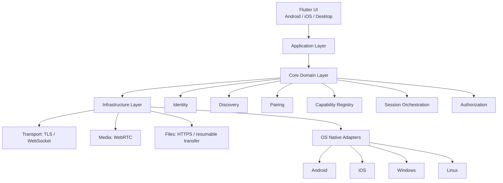

# Narad Architecture

## 1. Overview

Narad is a local-first cross-device communication platform designed to let users securely discover, pair, and interact with nearby devices over a LAN without requiring a cloud dependency. The system is built around the idea that a device should expose capabilities, not just identity.

The core product principle is simple:

- Discover devices on the local network
- Verify trusted identity through pairing
- Authorize specific capabilities per device
- Negotiate a secure session
- Exchange commands, media, or files over purpose-built channels

This architecture is intentionally designed to scale beyond a single app or operating system. It favors a platform-independent core, secure local transport, and OS-native adapters.

---

## 2. Product goals

### Primary goals

1. Allow users to securely connect nearby devices over local network infrastructure.
2. Expose capabilities such as screen sharing, audio, clipboard, file transfer, and device control.
3. Keep the protocol open and implementation-friendly for future client development.
4. Keep the system local-first, with privacy by default and no mandatory cloud dependency.
5. Make permissions capabilitiy-specific rather than device-wide.

### Non-goals for MVP

- Cloud relay or remote internet-based access
- Multi-user identity federation
- Full enterprise governance and policy management
- Cross-platform ecosystem marketplace at launch

---

## 3. Architectural principles

1. Separation of concerns
   - UI decides what the user wants.
   - Core logic decides how the system behaves.
   - Native adapters know how to access OS capabilities.

2. Capability-based interaction
   - Devices are not modeled as "a phone" or "a laptop" alone.
   - They are modeled as collections of capabilities, such as audio.output, clipboard, files, camera, and keyboard.

3. Zero-trust local networking
   - Discovery does not imply trust.
   - Pairing creates trust.
   - Authorization gates each operation.

4. Purpose-built transport planes
   - Control plane for metadata and session orchestration
   - Media plane for real-time streams
   - File plane for transfers and resumption

5. Local-first privacy
   - Sensitive data should remain on-device when possible.
   - Session keys should be device-local and not stored in a central cloud.

---

## 4. Target architecture



### Architectural rule

> Flutter knows what the user wants. The Narad core knows how devices communicate. Native adapters know how the operating system exposes capabilities.

---

## 5. Layered design

### 5.1 Presentation layer

Responsible for UX surfaces and user actions.

Examples:
- device list and discovery UI
- pairing flows with QR or verification code
- capability permission dialogs
- media controls and transfer status views

### 5.2 Application layer

Coordinates user intent and orchestrates workflows.

Examples:
- connect to device
- request speaker output
- start file transfer
- open clipboard sync session

### 5.3 Domain layer

Contains the universal logic of the protocol and the product model.

Key modules:
- identity
- discovery
- pairing
- capability registry
- permissions
- sessions
- authorization
- protocol codecs
- eventing

This layer should be platform independent and reusable across clients.

### 5.4 Infrastructure layer

Handles the actual operating-system and network implementation details.

Examples:
- mDNS/DNS-SD
- TLS sockets
- WebRTC peer connection management
- OS media capture and output
- file streaming and persistence
- local storage / secure key storage

---

## 6. Core runtime components

### 6.1 Identity service

Responsible for device identity and trust anchors.

Responsibilities:
- generate device keys
- maintain pairing relationships
- validate peer identity
- rotate or revoke trust when needed

### 6.2 Discovery service

Discovers nearby devices on the LAN.

Responsibilities:
- advertise device metadata over local network
- query peer devices
- expose device capability summaries
- classify device as reachable but untrusted until paired

### 6.3 Pairing service

Creates a cryptographic trust relationship between devices.

Recommended flows:
- QR code pairing for mobile-first UX
- numeric code pairing as fallback for desktop or accessibility scenarios

### 6.4 Capability registry

Defines and enumerates what the device can do.

Example capability model:

```json
{
  "device_id": "01abc...",
  "name": "My Phone",
  "platform": "android",
  "capabilities": [
    "audio.output",
    "audio.input",
    "camera",
    "clipboard",
    "files",
    "media.control"
  ]
}
```

### 6.5 Session manager

Tracks the lifecycle of every active relationship and data channel.

State transitions should follow a consistent model:

DISCOVERED -> AVAILABLE -> REQUESTED -> AUTHORIZED -> NEGOTIATING -> CONNECTED -> ACTIVE -> RELEASING -> CLOSED

### 6.6 Authorization engine

Checks whether a request is valid and allowed.

Every authorization decision should answer:
- Who is the requester?
- Is it paired?
- Is the capability allowed?
- Is the session valid?
- Does OS policy permit the operation?

---

## 7. Transport architecture

### 7.1 Control plane

Purpose: device metadata, pairing, permissions, and session negotiation.

Transport: TLS-protected channels over local network sockets or WebSockets.

Includes:
- capability discovery
- device metadata exchange
- pairing verification
- permission requests
- session creation and teardown
- clipboard synchronization
- command routing

### 7.2 Media plane

Purpose: real-time audio and video streams.

Transport: WebRTC with candidate negotiation and stream lifecycle management.

Includes:
- microphone capture
- speaker output
- camera streaming
- screen capture or display projection

### 7.3 File plane

Purpose: reliable file transfer and large payload movement.

Transport: HTTPS/TLS or resumable chunks over a dedicated transfer channel.

Includes:
- file upload/download
- resume support
- chunk validation
- transfer status and cancellation

---

## 8. Security model

Narad should follow zero-trust local networking principles.

### Security rules

- Discovery is not trust
- Same Wi-Fi is not sufficient access control
- Pairing establishes device identity
- Permission checks are capability-scoped
- Device OS policies remain final authority
- Sessions must be validated before execution

### Trust chain

```text
Local network discovery
    -> untrusted peer
    -> pairing handshake
    -> cryptographic identity
    -> authorization
    -> capability access
```

### Key principles

- Private keys remain on-device
- Pairing records are stored locally
- Authorization is explicit and revocable
- Sensitive operations require user confirmation

---

## 9. Permission model

Permissions should be specific and contextual.

Examples:
- files: allow read, write, receive
- speaker: allow output only
- camera: allow streaming
- clipboard: allow sync or read
- media.control: allow playback or seek

Permissions should be modeled at capability level rather than binary device-level access.

Example policy:

```text
Laptop -> Phone
  Files: Allow
  Speaker: Allow
  Camera: Deny
  Clipboard: Allow
  Microphone: Deny
```

This reduces privilege sprawl and makes UX understandable.

---

## 10. Data model and capability lifecycle

Every capability should transition through a predictable lifecycle:

```text
DISCOVERED -> AVAILABLE -> REQUESTED -> AUTHORIZED -> NEGOTIATING -> CONNECTED -> ACTIVE -> RELEASING -> CLOSED
```

An example flow:

```text
Laptop requests phone.audio.output
Phone validates pair relationship
Phone checks permission policy
WebRTC negotiation begins
Audio stream becomes active
User can stop or disconnect at any time
```

This model should be enforced in code so states are not ambiguous.

---

## 11. Platform integration strategy

Narad should avoid coupling the core to a single runtime or operating system.

### Recommended stack

- UI: Flutter
- Core logic: Rust
- Native integration: platform adapters
- Real-time media: WebRTC
- Discovery: mDNS / DNS-SD
- Security: device keypairs + local trust store

### Why this stack

- Flutter supports cross-platform user experiences quickly.
- Rust gives a strong platform-independent core with memory safety and performance.
- Native adapters keep OS-specific media and device access in the right place.
- WebRTC is well-suited to real-time audio and camera streaming.

---

## 12. Development constraints and decisions

### Architecture decisions

1. Keep the protocol independent from UI technology.
2. Keep capability definitions versioned and extensible.
3. Keep network planes separate to avoid overloading real-time media sessions.
4. Keep security validation explicit and not inferred from local network assumptions.
5. Make all user consent flows manifest and auditable.

### Engineering trade-offs

- Local-first reduces cloud cost but increases local protocol complexity.
- Capability-based design improves extensibility but requires a thoughtful registry model.
- WebRTC is excellent for media but not a full control-plane replacement.

---

## 13. MVP scope

The MVP should focus on the most valuable and testable flows:

1. local discovery of nearby peers
2. secure pairing by QR or numeric code
3. capability enumeration
4. permission-aware session creation
5. audio output sharing
6. clipboard synchronization
7. file transfer

This provides a compelling product story while keeping scope feasible.

---

## 14. Phase plan

### Phase 1: foundation
- device discovery
- peer identity and pairing
- secure control channel
- session lifecycle state machine

### Phase 2: media and file transfer
- WebRTC audio/video
- file transfer channel
- permission UI and capabilities

### Phase 3: trust and governance
- revocation flows
- policy management
- richer capability models

### Phase 4: ecosystem expansion
- more capabilities
- third-party client compatibility
- broader protocol interoperability

---

## 15. Summary

Narad should be built as a trust-aware, capability-driven, local-first platform. The architecture should not be modeled as a single monolithic app; instead, it should cleanly separate UI, core logic, permissions, protocol behavior, and OS-specific adapters.

This structure gives the project a strong foundation for growth while keeping implementation focused on the real product value: secure, seamless interaction between nearby devices.

✗ Calls

Store this policy locally.


---

11. WebRTC architecture

For real-time media:

Session Manager
                     │
               WebRTC Manager
                     │
         ┌───────────┴───────────┐
         │                       │
      Audio                   Video
         │                       │
       Opus              H.264/VP8/VP9

Use WebRTC's encrypted media transport rather than inventing your own encrypted RTP system.

The signaling itself can happen through your LocalLink control channel:

A ─── offer ───> B
A <── answer ─── B
A <─ ICE ──────> B
        │
        ▼
   WebRTC session


---

12. Audio architecture

Create a common abstraction:

AudioSource
AudioSink
AudioSession

Example:

Laptop audio
     ↓
AudioSource
     ↓
Resampler
     ↓
Opus encoder
     ↓
WebRTC
     ↓
Opus decoder
     ↓
AudioSink
     ↓
Phone speaker

For Windows:

WASAPI → LocalLink

For Linux:

PipeWire → LocalLink

For Android:

AudioRecord / AudioTrack

For iOS:

AVAudioSession / AVAudioEngine

The shared layer sees only:

AudioSource
AudioSink


---

13. Virtual devices

This should be a later phase, but it could become one of your killer features.

Imagine Windows showing:

Sound Output

○ Speakers
○ Headphones
● My Phone
○ LocalLink Tablet

And:

Microphone

○ Built-in Microphone
● My Phone
○ Bluetooth Headset

Linux could expose equivalent PipeWire nodes.

This allows applications such as video players, games and conferencing apps to use your devices without having explicit LocalLink support.


---

14. File synchronization

Don't implement synchronization as:

copy everything every time

Use a content/index model.

File
 │
 ├── path
 ├── size
 ├── modified_time
 ├── hash
 └── chunks

For large files:

2 GB file

chunk 1 ✓
chunk 2 ✓
chunk 3 ✓
chunk 4 ✗
chunk 5 ✗

If the connection dies:

Resume from chunk 4

Later you can add:

- conflict detection
- selective folders
- version history
- delta synchronization


---

15. Repository structure

For an open-source project, I'd use a monorepo initially.

locallink/
│
├── apps/
│   ├── mobile/
│   └── desktop/
│
├── packages/
│   ├── locallink_core/
│   ├── locallink_protocol/
│   ├── locallink_flutter/
│   └── locallink_ui/
│
├── native/
│   ├── android/
│   ├── ios/
│   ├── windows/
│   ├── linux/
│   └── macos/
│
├── protocol/
│   ├── v1/
│   ├── schemas/
│   └── examples/
│
├── docs/
│   ├── architecture/
│   ├── protocol/
│   ├── security/
│   ├── development/
│   └── contributing/
│
├── tests/
│   ├── integration/
│   ├── interoperability/
│   └── performance/
│
├── tools/
│   ├── protocol-generator/
│   └── test-device/
│
├── LICENSE
├── README.md
├── CONTRIBUTING.md
├── SECURITY.md
└── CODE_OF_CONDUCT.md


---

16. Open-source standard procedure

This is where I'd be quite disciplined.

Step 1 — Write the RFC before writing the implementation

Create:

docs/protocol/0001-device-discovery.md
docs/protocol/0002-pairing.md
docs/protocol/0003-capabilities.md
docs/protocol/0004-sessions.md
docs/protocol/0005-audio.md

Don't let the protocol exist only inside the code.


---

Step 2 — Define the protocol independently

Document things such as:

Device identity
Discovery
Pairing
Capabilities
Messages
Errors
Sessions
Versioning
Security

Someone should eventually be able to write a Python LocalLink client without looking at your Flutter code.

That's an excellent test of whether your architecture is genuinely open.


---

17. Use versioned schemas

Never do this:

{
  "action": "play"
}

without a protocol version.

Prefer something conceptually like:

{
  "version": 1,
  "type": "media.play",
  "request_id": "...",
  "payload": {}
}

Then future versions can evolve without destroying compatibility.


---

18. API design

Keep the public API small.

For example:

DeviceManager
CapabilityManager
PairingManager
SessionManager
TransferManager

Flutter gets:

devices.discover();

devices.pair(device);

sessions.request(
    device,
    capability: "audio.output",
);

The UI should not know:

- how mDNS works
- how TLS works
- how WebRTC works
- how Opus works
- how Android audio works

That's the job of the lower layers.


---

19. Testing strategy

Because this is a networking project, integration testing is more important than unit testing alone.

Create a test matrix:

Android  iOS  Windows  Linux
Android            ✓      ✓      ✓       ✓
iOS                ✓      ✓      ✓       ✓
Windows            ✓      ✓      ✓       ✓
Linux              ✓      ✓      ✓       ✓

Then test:

Discovery
Pairing
Authentication
File transfer
Clipboard
Audio
Video
Reconnect
Sleep/wake
Network change
Wi-Fi → hotspot
Device disappears
Device returns

Eventually automate as much as possible with physical/virtual test devices.


---

20. Reliability is a feature

Your app needs to survive:

Wi-Fi disconnect
       ↓
connection lost
       ↓
device disappears
       ↓
Wi-Fi reconnects
       ↓
device discovered
       ↓
session restored

Don't assume a connection stays alive.

Everything should have:

timeouts
retries
heartbeats
session IDs
reconnection
idempotent commands

For example, don't accidentally execute:

file.delete

twice because a network request was retried.


---

21. Observability

Add a developer diagnostics screen.

Something like:

LocalLink Diagnostics

Network
  Interface: Wi-Fi
  IPv4: 192.168.x.x

Discovery
  Status: Running
  Devices: 3

Control
  TLS: ✓
  RTT: 8 ms

WebRTC
  State: Connected
  Codec: Opus
  RTT: 22 ms
  Packet loss: 0.3%
  Jitter: 4 ms

Audio
  Sample rate: 48 kHz
  Buffer: 20 ms

This will save you enormous amounts of debugging time.


---

22. Don't build the cloud first

I'd deliberately make the initial architecture:

INTERNET
                X
                │
                │
       ┌────────▼────────┐
       │   Local Network │
       │                 │
       │ Phone ←→ Laptop │
       │   ↕       ↕     │
       │ Tablet ←→ TV    │
       └─────────────────┘

No account.

No central server.

No mandatory cloud.

Later, you can optionally add a cloud component for:

- remote device discovery
- pairing assistance
- NAT traversal
- remote access
- encrypted backup
- account synchronization

But the core protocol shouldn't depend on it.


---

23. Suggested development order

I'd build it in this exact order:

FOUNDATION
                       │
                       ▼
              Device identity
                       │
                       ▼
                  Discovery
                       │
                       ▼
                    Pairing
                       │
                       ▼
                 Secure channel
                       │
                       ▼
               Capability system
                       │
             ┌─────────┴─────────┐
             ▼                   ▼
        File transfer        Clipboard
             │
             ▼
          Sessions
             │
             ▼
         WebRTC media
             │
       ┌─────┼─────┐
       ▼     ▼     ▼
     Audio Camera Media
       │
       ▼
   Virtual devices
       │
       ▼
    Call integration

Don't start with calls.

Calls are one of the hardest features because you're crossing into operating-system telephony restrictions. Build the device/capability/session architecture first so calls become another platform-specific capability rather than something the entire project depends upon.


---

24. The first milestone

Your first public release should be very small:

LocalLink v0.1

Android ↔ Windows

- Device discovery
- QR pairing
- Secure connection
- Device dashboard
- File transfer
- Clipboard sync
- Phone → PC microphone
- PC → phone speaker
- Reconnection

If those work beautifully, you already have a meaningful project.

Then:

v0.2

- Linux
- camera streaming
- media control
- remote trackpad

v0.3

- iOS
- additional audio capabilities
- better background behavior

v0.4

- virtual microphone
- virtual speaker
- virtual camera

v0.5+

- platform-specific calling integrations
- device groups
- multi-device audio
- synchronization
- plugins/extensions


---

25. One final architectural decision I'd make

I would actually give the project three public layers:

┌─────────────────────────────────────────┐
│              LocalLink UI               │
│              Flutter                    │
└─────────────────────────────────────────┘
                     │
┌─────────────────────────────────────────┐
│          LocalLink SDK                  │
│     Dart / Rust / platform bindings     │
└─────────────────────────────────────────┘
                     │
┌─────────────────────────────────────────┐
│        LocalLink Protocol               │
│       Open + documented + versioned     │
└─────────────────────────────────────────┘

That way the open-source community can contribute at different levels.

Someone can build a new Flutter UI without touching the protocol.

Someone can build a Python/Go/Rust client without using Flutter.

Someone can add a new capability without rewriting discovery/security.

And someone can implement LocalLink on a completely new platform.

That's the architecture I'd choose for an open-source project with the ambitions you're describing.